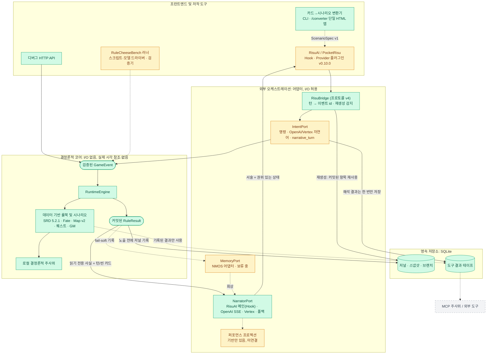

# SAGA — Stateful Agentic Game Architecture

**한국어** | [English](README.md)

[](https://github.com/Sallos725/SAGA/actions/workflows/ci.yml)
[](pyproject.toml)
[](LICENSE)
[](docs/IMPLEMENTATION_PLAN.md)

장기간 이어지는 에이전트 기반 게임과 RisuAI를 위한, 결정론적이며 리플레이 가능한 TRPG 런타임입니다.

[빠른 시작](#빠른-시작) · [RisuAI 플러그인](packs/risu-starter/README.md) · [아키텍처](docs/ARCHITECTURE.md) · [제품 방향](docs/DIRECTION.md) · [규칙 세트](packs/rulesets/README.md) · [룰북 작성](docs/RULEBOOKS.md) · [기여 안내](CONTRIBUTING.md)

프롬프트에 의존하는 챗봇을 하나 더 만드는 대신, 각 구성 요소의 책임을 명확히 나누는 것을 목표로 합니다.

- **런타임 / 게임 상태**는 HP, 인벤토리, 위치, 맵, 상태 이상, 퀘스트, 진행 시계, 이벤트 순서 등 게임의 기준이 되는 정확한 사실을 관리합니다.
- **의미 기반 메모리**는 `MemoryPort` 뒤에 두는 선택 사항입니다. 메모리를 사용하지 않거나, 테스트용 가짜 어댑터, NMOS 또는 다른 구현으로 회상과 검색을 처리할 수 있습니다.
- **주사위 / 도구**는 계산과 외부에서 검증할 수 있는 도구 결과를 담당합니다.
- **LLM**은 허용된 범위 안에서 의도를 해석하고 이미 결정된 결과를 서술합니다. 게임의 기준 상태를 직접 변경하지 않습니다.
- **RisuAI**는 프런트엔드이자 카드·로어 전달 인터페이스이며, 게임 상태의 최종 기준은 아닙니다.
- **RuleCheeseBench**는 동일한 런타임을 재사용하여 리플레이 가능한 시나리오에서 모델을 비교합니다.

SAGA는 SQLite 기반 영속 상태, 검증된 리플레이, 불변 분기(branching), 도구 결과 테이프,
데이터 기반 룰북(`SRD 5.2.1`·`Fate Condensed` 일부), 시나리오 카드, 시각적 카드→시나리오
변환기(`tools/saga-converter.html` / `GET /converter`), 그리고 듀얼 모드 RisuAI/PocketRisu
플러그인(RisuAI 자체 메인 모델과 프리셋을 유지하는 **Hook 모드**, 또는 OpenAI 호환 SSE
스트리밍·선택적 Vertex JSON·무키 명령 폴백을 지원하는 **Provider 모드**)을 제공합니다.

> **현재 상태:** 초기 프로토타입입니다. 코어 런타임, 데이터 룰북, 시나리오, Hook/Provider
> 플러그인(`v0.10.0`), 탐험·퀘스트·GM 보정, 카드 변환기까지 Python 647개 + Node 37개
> 테스트를 통과했습니다. 최근 추가된 M1–M3 및 A2 기능은 오프라인 검증을 마쳤으며 실제 호스트
> 라이브 플레이테스트가 남아 있습니다. 운영용 NMOS, MCP 주사위, 라이브 RuleCheeseBench
> 실행은 현재 보류(deferred) 상태입니다.

## 한눈에 보는 구조

초록은 구현 완료, 노랑은 부분 구현/오프라인 검증, 회색 점선은 계획 단계입니다. 자세한 내용은
[아키텍처](docs/ARCHITECTURE.md), [제품 방향](docs/DIRECTION.md),
[로드맵](docs/IMPLEMENTATION_PLAN.md)을 참고하세요.



읽는 방법:

- 사용자 턴은 프런트엔드로 들어와 검증된 `GameEvent`(일반 RP 턴은 상태를 바꾸지 않는
  `narrative_turn`)가 된 뒤에야 결정론적 코어에 도달합니다.
- 코어는 무엇이든 노출하기 전에 `RuleResult`를 저널에 커밋합니다. 서술은 커밋된 사실만 읽습니다.
- 재생성은 저널로 되돌아가므로, 서술은 바뀌어도 상태와 주사위는 바뀌지 않습니다.
- 모델 해석이나 향후 MCP 도구처럼 비결정적인 결과는 도구 결과 테이프에 한 번만 저장하고
  거기서 다시 읽습니다.
- 메모리는 게임 상태 옆에 따로 있습니다. 기록이나 회상이 실패하면 서술 품질만 떨어지고
  상태는 영향을 받지 않습니다.

앞으로의 방향 ([플레이 우선 로드맵](docs/DIRECTION.md)):


## 설계 배경

SAGA는 Aethrion 같은 결정론적 RP 엔진의 핵심 원칙을 따릅니다. 재생성(reroll)으로 서술은 바꿀 수 있지만,
상태나 주사위 결과가 달라져서는 안 됩니다. 장기 메모리는 선택적으로 연결하는 외부 어댑터이며,
SAGA는 게임 엔진 안에 별도의 메모리 시스템을 내장하지 않습니다.

## 반드시 지켜야 할 불변 조건

1. **게임의 기준 상태는 메모리와 다릅니다.** 정확한 HP, 아이템 수량, 퀘스트 단계처럼 정확성이 필요한 값을 NMOS에 맡기지 않습니다.
2. **재생성은 도구를 두 번 실행하지 않습니다.** 주사위와 도구의 출력은 한 번만 저널에 기록하고, 이후에는 기록된 결과를 재사용합니다.
3. **확정된 모든 상태 변경은 이벤트까지 추적할 수 있어야 합니다.**
4. **핵심 규칙은 시스템 시각을 읽거나 I/O를 수행하지 않습니다.** 시간은 명시적인 이벤트로 전달합니다.
5. **LLM 출력을 신뢰할 수 있는 상태로 취급하지 않습니다.** 파싱한 의도는 디스패치 전에 허용 항목이 명시된 닫힌 스키마로 검증해야 합니다.
6. **메모리 장애는 제한된 기능 저하로 처리합니다.** 일시적인 NMOS 장애로 회상 품질은 낮아질 수 있지만, 게임 상태가 손상되어서는 안 됩니다.
7. **벤치마크 실행은 재현 가능해야 합니다.** 시나리오, 규칙 버전, 시드, 모델 설정, 이벤트 저널을 함께 기록합니다.

## 빠른 시작

### 1. 로컬 실행 (Python 3.11–3.13)

```bash
python -m venv .venv
source .venv/bin/activate  # Windows PowerShell: .venv\Scripts\Activate.ps1
python -m pip install -e '.[dev,api]'
cp .env.example .env       # 선택: LLM 항목을 비워 두면 API 키 없이 동작합니다
pytest
uvicorn saga_trpg.api.app:create_app --factory --reload --port 4850
```

결정론적 HTTP API 동작 확인:

```bash
curl -s -X POST http://127.0.0.1:4850/worlds/demo/events \
  -H 'content-type: application/json' \
  -d '{"event_id":"turn-1","kind":"attack","actor_id":"player","payload":{"target_id":"goblin","attack_bonus":5,"target_ac":14,"damage":"1d8+3"}}'

curl -s http://127.0.0.1:4850/worlds/demo/state
```

브라우저에서 **`http://127.0.0.1:4850/converter`**를 열거나 `tools/saga-converter.html` 파일을
직접 열면 기존 `.charx`, `.png`, `.json` 캐릭터 카드를 SAGA 시나리오로 변환할 수 있습니다.

월드는 `./data/worlds.sqlite3`에 영속 저장됩니다(`TRPG_DATA_DIR`로 경로 변경 가능). 같은
이벤트 ID 또는 멱등성 키로 요청을 반복하면 기록된 결과를 재사용합니다. 재시작 복구, 스냅샷,
리플레이, 분기, 마이그레이션은 [영속 저장 계약](docs/PERSISTENCE.md)을 참고하세요.

### 2. RisuAI / PocketRisu에서 플레이하기

1. 위 방법으로 SAGA 서버를 실행하거나, [deploy/README.md](deploy/README.md) 안내에 따라 격리된
   Docker 스택을 실행합니다.
2. RisuAI / PocketRisu의 **설정 → 플러그인**에서
   [`packs/risu-starter/saga_provider.js`](packs/risu-starter/saga_provider.js)(`v0.10.0`)를
   가져오고, 호스트 설정에서 `useSayNothing=false`로 지정합니다.
3. 플러그인 설정 또는 채팅 화면의 SAGA 패널에서 `server_url`과 고정된 `host_instance_id`를
   설정한 뒤 원하는 모드를 선택합니다.
   - **Hook 모드 (`integration_mode=hook`)**: 기존 RisuAI 메인 모델, 프리셋, 로어북, 스트리밍을
     그대로 유지합니다. SAGA 룰북 모듈(`packs/rulesets/srd-5.2.1/risu-module.json`,
     `packs/rulesets/fate-condensed/risu-module.json` 등)을 켜거나 SAGA 패널에서 현재 카드를
     시나리오로 변환하면 자동 활성화됩니다. 생성 직전(`POST /v1/saga/turn`)에 판정을 확정하고
     읽기 전용 사실과 확정 푸터/턴 카드를 붙입니다.
   - **Provider 모드 (`integration_mode=provider`)**: 메인 모델로 **SAGA SRD Demo**를 선택합니다.
     API 키 없이 명령·기본 서술로 바로 테스트할 수 있으며, `.env`에 OpenAI 호환 엔드포인트
     (`SAGA_LLM_BASE_URL` / `SAGA_NARRATOR_MODEL`, `provider_stream=true`로 SSE 스트리밍 지원)
     또는 선택적 Vertex 서비스 계정 JSON을 연결할 수도 있습니다.

플러그인 옵션, 명령어, 수정·재생성 동작, 인증정보 경계는
[packs/risu-starter/README.md](packs/risu-starter/README.md)를 참고하세요.

### 3. 로컬 검증 (CI와 동일)

```bash
pytest
ruff check .
ruff format --check .
python -m compileall src
node --test tests/risu_provider.test.cjs
```

GitHub Actions는 Python 3.11, 3.12, 3.13에서 전체 테스트를 실행하고, Node.js 22에서 플러그인
테스트를 함께 실행합니다.

번들 규칙 예제로 **SRD 5.2.1**(CC BY 4.0)과 **Fate Condensed**(CC BY 3.0)를 제공하며, 각각
RisuAI 모듈(`risu-module.json`)과 예제 시나리오
(`packs/scenarios/black-tower-outpost/scenario.json`)를 포함합니다. 지원 범위와 저작자 표시는
[packs/rulesets/README.md](packs/rulesets/README.md) 및
[docs/RULESET_LICENSES.md](docs/RULESET_LICENSES.md)를 참고하세요.

## 프로젝트 구조

```text
src/saga_trpg/
  domain/        순수 데이터 모델, 맵, 시드 기반 맵 생성, 이벤트, 브랜치
  runtime/       이벤트 디스패치, 저널, 리플레이, 해싱, 결정론적 난수 생성
  ports/         메모리, 주사위, 서술, 의도 해석, 도구, 퍼포먼스 인터페이스
  adapters/      SQLite 저장소·테이프, NMOS, 로컬/MCP 주사위, OpenAI/Vertex, RisuAI 브리지
  modules/       직접 작성한 예제 규칙 세트 (정답지로 유지)
  rulebooks/     룰북·시나리오 스키마, 수식 엔진, 카드 변환기, .risum/.charx 내보내기
  presentation/  선택적 퍼포먼스 프로젝션 기반
  benchmark/     RuleCheeseBench 러너, 드라이버, 검증기, 리포트 생성기
  api/           얇은 FastAPI HTTP 서버 (디버그 API, /v1/saga/*, /converter)

packs/
  risu-starter/  RisuAI/PocketRisu 플러그인 (v0.10.0) 및 시작 카드
  rulesets/      번들 SRD 5.2.1 및 Fate Condensed 모듈
  scenarios/     예제 시나리오 팩 (예: black-tower-outpost)

tools/
  saga-converter.html  외부 CDN 없는 단일 HTML 시각적 카드→시나리오 변환기

docs/
  ARCHITECTURE.md
  DIRECTION.md
  IMPLEMENTATION_PLAN.md
  RULEBOOKS.md
  RISUAI_INTEGRATION.md
  RULECHEESEBENCH_SPEC.md
  adr/
  progress/
```

## 현재 구현 상태

구현된 기능:

- **결정론적 런타임과 영속 저장소**: 이벤트·상태 모델, 월드+이벤트+주사위 키 기반 결정론적
  주사위, 스냅샷·검증 리플레이·불변 분기·멱등성을 갖춘 SQLite 저널, 명시적 v1 → v2 저장소
  마이그레이션, 범용 도구 결과 테이프
- **데이터 기반 룰북과 RisuAI 모듈**: 닫힌 JSON 스키마 + 수식 언어 + 범용 엔진, 번들
  `srd-5.2.1@0.6.0` 및 `fate-condensed@0.5.0`(이전 버전 바이트 단위 보존), 상태 이상 효과,
  레코드, 인벤토리, 시뮬레이션 시간, `.json`/`.risum`/`.charx` 내보내기, `POST /rulebooks`
  가져오기 ([작성 가이드](docs/RULEBOOKS.md), [ADR 0007](docs/adr/0007-rulebooks-as-data.md))
- **RisuAI 플레이 기반 (M1, 프로토콜 v4)**: 순수 RP 턴용 무상태 `narrative_turn`, Hook 모드
  판정 엔드포인트(`POST /v1/saga/turn`), OpenAI 호환 서술·의도 어댑터(`risu_prompt`, SSE
  스트리밍, `reasoning_effort`/`custom_headers`/`custom_body` 지원), 선택적 Vertex 서술·의도,
  전체화면 설정·상태 패널이 포함된 듀얼 모드 플러그인 `v0.10.0`
  ([ADR 0010](docs/adr/0010-narrative-turn-and-hook-mode.md))
- **시나리오와 자유 행동 판정 (M2)**: 룰북 규칙과 초기 월드를 분리한 `ScenarioSpec` v1, 룰북
  행동·출구에 근거한 자연어 의도 해석, 도구 테이프 위에서 동작하는 결정론적 자유 행동 GM 판정
  (`adjudicate_action`) ([ADR 0011](docs/adr/0011-scenarios-and-free-action-adjudication.md))
- **탐험, 퀘스트, GM 보정, UI 카드 (M3)**: Map v2(잠긴 출구, 루팅, 방 조사·단서, NPC 이동),
  퀘스트 추적(`quest_update`), 추가 전용 GM 보정(`gm_correction`), 권위 있는 B1 턴 카드 및
  B2 씬 보드 프로젝션 ([ADR 0012](docs/adr/0012-exploration-gm-correction-and-cards.md))
- **카드→시나리오 변환기와 동적 레지스트리 (A2)**: `.charx`/`.png`/`.json` 다중 포맷 변환기
  (무LLM 결정론적 추출 + 선택적 LLM 보강, CLI / `POST /v1/saga/convert` / 단독
  `tools/saga-converter.html` / 플러그인 내 패널 지원), 플레이 중 동적 `register_actor`·`add_room`
  ([ADR 0013](docs/adr/0013-card-conversion-and-dynamic-registry.md))
- **선택적 연동 및 벤치마크 기반**: fail-soft NMOS 사이드카 0.3.0 어댑터(`SAGA_NMOS_URL`
  미설정 시 비활성), MCP Dice 포트 계약, 오프라인 RuleCheeseBench 러너(시나리오 스키마 v2,
  시드/테이프 주사위, 선언형 검증기, 모델 드라이버, 리포트 생성기)

아직 구현되지 않았거나 보류된 항목:

- M1–M3 및 A2 기능의 실제 브라우저/RisuAI 호스트 라이브 E2E 플레이테스트 검증(현재 오프라인 검증 완료)
- 실제 NMOS 사이드카 라이브 왕복, 액터별 회상 가시성, 메모리 ablation 실험
- 실제 서비스용 MCP 주사위 클라이언트 바인딩 및 불확실한 실행 결과의 재조정 정책
- 유료 LLM 기반 RuleCheeseBench 라이브 실행 및 판정기(judge) 도구
- 완전한 상용 수준의 TRPG 규칙(아이템 효과, 사망·성장 규칙, 다중 턴 전투 자동화) 및 운영용 멀티테넌트 HTTP 인증
- 퍼포먼스/TTS 프로젝션 연결

코딩 에이전트와 함께 이 저장소에서 작업할 때는 [docs/AGENT_HANDOFF.md](docs/AGENT_HANDOFF.md)부터 확인하세요.

## 보안 및 배포 참고 사항

- 로컬 자격 증명은 `.env`에, 저장한 캠페인은 `data/` 아래에 보관하세요. Git과 Docker 제외 규칙은
  `.env`, 개인 키, SQLite 데이터베이스, 백업, 로컬 캐시를 제외하며 `.env.example`에는 공개용
  예시만 포함합니다.
- 디버그 HTTP 서버에는 아직 **운영 환경용 인증이나 멀티테넌트 격리가 없습니다**. `127.0.0.1`
  또는 신뢰할 수 있는 사설 네트워크에만 바인딩하세요.
- 기존 저장소 v1 데이터베이스는 서버 시작 전에 백업을 포함한 명시적 업그레이드가 필요합니다.

  ```bash
  python -m saga_trpg.adapters.storage.migrations data/worlds.sqlite3 \
    --backup data/worlds.pre-v2.sqlite3
  ```

## 라이선스

SAGA 소스 코드는 [MIT 라이선스](LICENSE)를 따릅니다.

번들 예제 규칙 세트는 공개 라이선스 SRD 자료(**SRD 5.2.1** CC BY 4.0, **Fate Condensed**
CC BY 3.0)를 포함합니다. 해당 예제를 재배포할 때는
[docs/RULESET_LICENSES.md](docs/RULESET_LICENSES.md)에 명시된 저작자 표시 안내를 함께
유지하세요.

설치 방법, 지원 기능, 제약 사항을 변경할 때는 `README.md`와 `README.ko.md`를 같은 변경에서 함께 갱신하세요.
