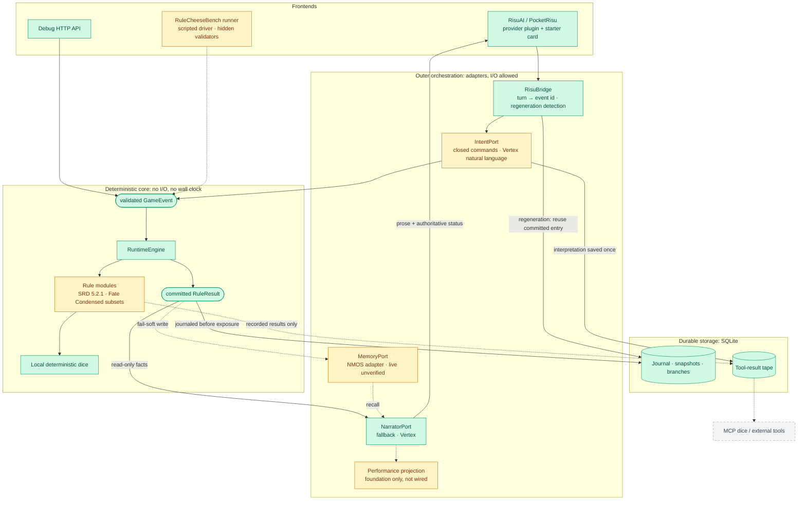
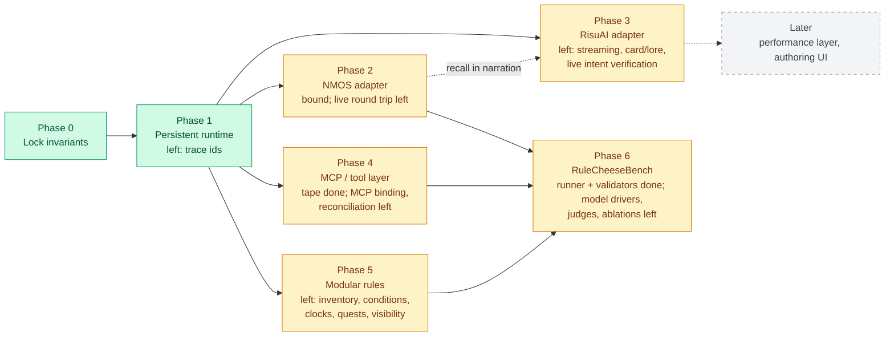

# SAGA — Stateful Agentic Game Architecture

[한국어](README.ko.md) | **English**

[](https://github.com/Sallos725/SAGA/actions/workflows/ci.yml)
[](pyproject.toml)
[](docs/IMPLEMENTATION_PLAN.md)

A deterministic, replayable TRPG runtime for long-horizon agent-driven games and RisuAI.

[Quick start](#quick-start) · [Architecture](docs/ARCHITECTURE.md) · [Roadmap](docs/IMPLEMENTATION_PLAN.md) · [Rulesets](packs/rulesets/README.md) · [Write a rulebook](docs/RULEBOOKS.md) · [Contributing](CONTRIBUTING.md)

The design goal is not to build another prompt-heavy chatbot. It is to split responsibilities cleanly:

- **Runtime / game state** owns authoritative facts: HP, inventory, positions, conditions, quest state, clocks, and event ordering.
- **Semantic memory** is optional behind `MemoryPort`: use no memory, a fake adapter, NMOS,
  or another implementation for recall and retrieval.
- **Dice / tools** own calculations and externally verifiable tool results.
- **LLM** interprets constrained intent and narrates already-decided outcomes. It never directly mutates authoritative state.
- **RisuAI** is a frontend and card/lore delivery surface, not the source of truth.
- **RuleCheeseBench** reuses the exact same runtime to compare models under replayable scenarios.

SAGA provides persistent state, replay, branching, and durable external tool results.
The PocketRisu command demo connects stable user turns to that runtime without NMOS,
with optional bounded Vertex natural-language attack/check/save proposals and narration after
commit. Production NMOS, MCP, and general card/lore bindings remain separate integration work.

## Architecture at a glance

Green is implemented, amber is partial, dashed grey is planned. Details live in
[the architecture](docs/ARCHITECTURE.md) and [the roadmap](docs/IMPLEMENTATION_PLAN.md).



How to read it:

- A user turn enters through a frontend, becomes a validated `GameEvent`, and only then
  reaches the deterministic core.
- The core commits a `RuleResult` to the journal before anything is shown. Narration only
  reads committed facts.
- Regeneration goes back to the journal, so prose may change while state and dice do not.
- Anything non-deterministic, such as model interpretation or future MCP tools, is saved
  once on the tool-result tape and replayed from there.
- Memory sits beside game state. A failed write or recall can degrade prose, never state.

Where it is heading, in the recommended order rather than as strict dependencies:



## Why this shape

SAGA borrows one strong idea from deterministic RP engines such as Aethrion: a reroll may
change prose, but it must not change state or dice. Long-horizon memory is an optional external
adapter; SAGA does not embed a second memory system into the game engine.

## Non-negotiable invariants

1. **Authoritative state is not memory.** Do not ask NMOS to remember exact HP, inventory counts, quest stages, or other values that must be exact.
2. **Reroll does not execute tools twice.** Dice/tool outputs are journaled once and replayed.
3. **Every committed state mutation is traceable to an event.**
4. **Core rules do not read wall-clock time or perform I/O.** Time enters as explicit events.
5. **LLM output is not trusted state.** Parsed intents must be validated against a closed schema before dispatch.
6. **Memory failures are fail-soft.** A temporary NMOS outage may reduce recall quality but must not corrupt game state.
7. **Benchmark runs are reproducible.** Scenario, rule version, seed, model config, and event journal are captured.

## Quick start

For the API-key-free PocketRisu **6011** playtest, use the
[isolated deployment](deploy/README.md) and [starter card/provider](packs/risu-starter/README.md).
Send `attack opponent`, `check strength 10`, or `save dexterity 12`, or dice-free state commands
such as `damage opponent 5`, `inflict opponent prone` and `wait 1 hour`; regeneration reuses the
committed event and dice. This is a limited SRD subset. Fallback narration needs no key.
For optional Gemini natural-language intent and narration, open
**Settings → Plugins → SAGA SRD Demo → Vertex 서비스 계정 JSON** and paste the entire
service-account JSON. Keep **SAGA SRD Demo** as main; SAGA derives the project/global endpoint
and uses **Gemini 3.8 Flash** automatically. No other model settings are needed. Blank input
keeps command fallback. Narration failure preserves committed facts; uncertain interpretation
returns a pending error without automatic retry. See the
[setup and credential boundaries](packs/risu-starter/README.md#optional-vertex-narration).
With plugin/card 0.4.0 and backend protocol 3, examples include `상대를 공격한다` and
`힘으로 난이도 10 판정을 한다`. Targets and check/save DCs must be explicit. New accepted
natural actions can make two model calls; regeneration makes zero interpretation calls and
at most one narration call. Natural text edits intentionally create a new action. The new
slice passed offline tests and an independent plugin/API/SQLite harness. Backend/plugin 0.4.0
are now deployed on 6011: `상대를 공격한다` and one regeneration passed with fresh prose and
unchanged state, rolls, journal and tape. The existing host card was retained; the new starter
card was not imported. Checks/saves and broader language quality remain live-unverified. See
the [bounded live report](docs/progress/risu-natural-intent-live.md); actual billed cost was not observed.
The earlier narration-only version had two approved live calls on 6011; that evidence does
not verify the new intent behavior or actual billed costs.

Set `useSayNothing=false` in host settings for this demo. Full non-comment history, including
hidden context, is limited to 256 user turns; semantic latest-action edits fork safely, while
changed earlier history must be resumed
from its first uncommitted turn. Disable the demo plugin when selecting another main provider.

Protocol 3 retains v2 world/command identities, cosmetic command normalization and committed
hidden turns; existing v2 chats continue without a reset.
Existing v1 chats remain read-only for exact original-history replay; start a new chat for v2
actions. Client-controlled message ids and the known seed still make this a trusted demo, not adversarial
benchmark isolation. See the [identity fix report](docs/progress/risu-identity-context-fix.md).

```bash
python -m venv .venv
source .venv/bin/activate  # Windows: .venv\\Scripts\\activate
python -m pip install -e '.[dev,api]'
pytest
uvicorn saga_trpg.api.app:create_app --factory --reload --port 4850
```

Then try:

```bash
curl -s -X POST http://127.0.0.1:4850/worlds/demo/events \
  -H 'content-type: application/json' \
  -d '{"event_id":"turn-1","kind":"attack","actor_id":"player","payload":{"target_id":"goblin","attack_bonus":5,"target_ac":14,"damage":"1d8+3"}}'

curl -s http://127.0.0.1:4850/worlds/demo/state
```

The debug API now persists worlds to `./data/worlds.sqlite3` (`TRPG_DATA_DIR` overrides the
directory). Repeating a request with the same event id or idempotency key returns its recorded
result. Use a new identity for a new action. See [the persistence contract](docs/PERSISTENCE.md)
for restart recovery, snapshots, replay, branching, and failure behavior.

The distribution is `saga-trpg`; Python imports use `saga_trpg`. Reinstall the editable package
after upgrading an older checkout. No import alias for the former package is provided.
Existing storage v1 databases need an explicit, backed-up upgrade before starting the host:

```bash
python -m saga_trpg.adapters.storage.migrations data/worlds.sqlite3 \
  --backup data/worlds.pre-v2.sqlite3
```

Stop the host first and choose a new backup filename. Current v2 databases are a no-op;
unknown versions fail closed. Event/state schema v1 and runtime semantics remain unchanged.

Use Python 3.11–3.13 and the same verification commands locally as CI:

```bash
pytest
ruff check .
ruff format --check .
python -m compileall src
```

GitHub Actions runs the complete suite on all three versions for pushes and pull requests.
The provider tests also run in CI with Node.js 22: `node --test tests/risu_provider.test.cjs`.

Two selectable system examples are available: **SRD 5.2.1** (CC BY 4.0) and **Fate Condensed**
(CC BY 3.0). Each includes typed action handlers, a module manifest, the shared bot description,
a system prompt, sample actors/actions, and attribution. See
[the ruleset examples](packs/rulesets/README.md) for creation commands and exact supported scope.
These are partial examples. Each ships as a RisuAI module (`risu-module.json`); enable it in
PocketRisu and a new chat plays by that rulebook (see [the module format](docs/RISUAI_MODULES.md)).

## Project map

```text
src/saga_trpg/
  domain/        Pure data models
  runtime/       Event dispatch, journal, replay, deterministic RNG
  ports/         Interfaces for memory, dice, narration, intent
  adapters/      NMOS, local/MCP dice, RisuAI/OpenAI-compatible adapters
  modules/       Hand-written example rulesets (kept as oracles)
  rulebooks/     Rulebook schema, formula language, generic engine, bundled data
  benchmark/     RuleCheeseBench harness
  api/           Thin HTTP host

docs/
  ARCHITECTURE.md
  IMPLEMENTATION_PLAN.md
  AGENT_HANDOFF.md
  RULECHEESEBENCH_SPEC.md
  RISUAI_INTEGRATION.md
  adr/
```

## Current implementation

Implemented:

- event/state models
- deterministic dice keyed by world + event + roll key
- in-memory/JSONL journals and a transactional SQLite world repository
- periodic snapshots, verified replay, and independent branches with fork provenance
- persistent idempotency by event id or idempotency key
- explicit storage v1 → v2 migration with backup, rollback, and replay validation
- generic SQLite tool-result tape and a repository path for taped external dice results
- selectable, versioned SRD 5.2.1 and Fate Condensed example modules with closed action schemas
- SRD 5.2.1 `0.2.0` state actions: GM-declared damage/heal, explicit named conditions,
  and simulated time; `0.1.0` worlds keep their exact action set
  ([ADR 0006](docs/adr/0006-ruleset-versions-and-state-actions.md),
  [progress report](docs/progress/srd-state-actions.md))
- SRD 5.2.1 `0.3.0` inventory: exact per-actor item counts with closed keys (`give`/`take`),
  no item effects
- **Rulebooks as data**: a closed JSON schema plus a small formula language, one generic
  engine, a `check` command with errors by entry; `srd-5.2.1@0.5.0` and `fate-condensed@0.4.0`
  are the bundled rulebooks (older bundled versions stay registered byte for byte); rulebooks
  ship as RisuAI modules, import at `POST /rulebooks`, and drive commands and the footer
  ([guide](docs/RULEBOOKS.md), [module format](docs/RISUAI_MODULES.md),
  [ADR 0007](docs/adr/0007-rulebooks-as-data.md))
- PocketRisu commands for those actions (`damage`, `heal`, `inflict`, `cure`, `wait`,
  `give`, `take`) and a compact read-only status footer; new bridge worlds pin the latest
  version, existing worlds keep theirs and reject newer commands without changing
- replayable generic-fantasy attack rule
- FastAPI debug endpoints
- a versioned OpenAI-shaped Risu completion adapter with immutable host-turn mapping
- PocketRisu v3 provider and starter card for no-memory SRD commands and authoritative status
- opt-in Vertex natural-language attack/check/save proposals on the existing durable tape
- Vertex narration from the same service-account JSON input, after commit with bounded fallback
- an NMOS sidecar 0.3.0 memory adapter (fail-soft, stateless, off unless `SAGA_NMOS_URL` is
  set; see [docs/NMOS_SIDECAR.md](docs/NMOS_SIDECAR.md)) and an MCP Dice port with an explicit
  TODO contract
- RuleCheeseBench runner on the production runtime: scenario schema v2, seed/tape dice,
  declarative hidden validators, scripted driver, reproducible run artifacts
- tests for the most important invariants

Not implemented yet:

- a live NMOS round trip and actor-scoped recall
- production MCP client binding
- live checks/saves and broader language quality/scope for the limited intent adapter
- general RisuAI card/lore compatibility and streaming (narration copies only bounded text context)
- legacy JSONL import and future state/event semantic migrations
- complete TRPG rulesets (item effects, quest flags, visibility, condition effects, death)
- RuleCheeseBench model drivers, judges, memory ablations and reports

Start with `docs/AGENT_HANDOFF.md` if you are handing this repo to Codex or Claude Code.

## Safety / deployment note

Keep local credentials in `.env` and saved campaigns under `data/`. Git and Docker build
exclusions cover local environment files, private keys, databases and their sidecar files,
journals, backups, and local caches. `.env.example` contains public placeholders and remains
included. Supply configuration at runtime; it is not baked into the image.

The debug HTTP host has no production authentication or multi-tenant isolation yet. Bind it to localhost/private networking until the outer API/auth layer is implemented and reviewed.

The action-demo bundle lives under `packs/risu-starter/`. Its v2 card and v3 provider target
the pinned PocketRisu 1.13.0 host. See the starter guide for supported commands, edit/retry
behavior and capacity limits.

When changing setup instructions, supported features, or limitations, update both
`README.md` and `README.ko.md` in the same change.
