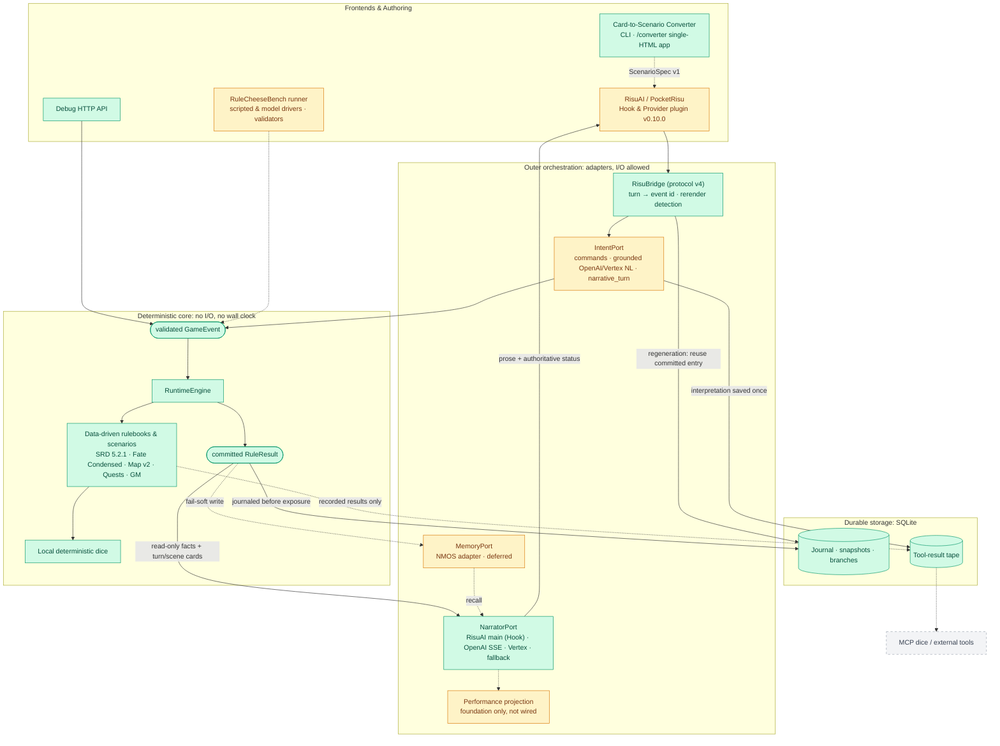

# SAGA — Stateful Agentic Game Architecture

[한국어](README.ko.md) | **English**

[](https://github.com/Sallos725/SAGA/actions/workflows/ci.yml)
[](pyproject.toml)
[](LICENSE)
[](docs/IMPLEMENTATION_PLAN.md)

A deterministic, replayable TRPG runtime for long-horizon agent-driven games and RisuAI.

[Quick start](#quick-start) · [RisuAI plugin](packs/risu-starter/README.md) · [Architecture](docs/ARCHITECTURE.md) · [Direction](docs/DIRECTION.md) · [Rulesets](packs/rulesets/README.md) · [Write a rulebook](docs/RULEBOOKS.md) · [Contributing](CONTRIBUTING.md)

The design goal is not to build another prompt-heavy chatbot. It is to split responsibilities cleanly:

- **Runtime / game state** owns authoritative facts: HP, inventory, positions, maps, conditions, quests, clocks, and event ordering.
- **Semantic memory** is optional behind `MemoryPort`: use no memory, a fake adapter, NMOS, or another implementation for recall and retrieval.
- **Dice / tools** own calculations and externally verifiable tool results.
- **LLM** interprets constrained intent and narrates already-decided outcomes. It never directly mutates authoritative state.
- **RisuAI** is a frontend and card/lore delivery surface, not the source of truth.
- **RuleCheeseBench** reuses the exact same runtime to compare models under replayable scenarios.

SAGA provides persistent SQLite state, verified replay, immutable branching, durable tool tapes,
data-driven rulebooks (`SRD 5.2.1` and `Fate Condensed` subsets), scenario cards, a visual
Card-to-Scenario converter (`tools/saga-converter.html` / `GET /converter`), and a dual-mode
RisuAI/PocketRisu plugin (**Hook mode** using your own RisuAI main model + presets, or **Provider
mode** with OpenAI-compatible SSE streaming, optional Vertex JSON, or zero-API-key fallback).

> **Status:** Early prototype. Core runtime, rulebooks, scenarios, Hook/Provider plugin (`v0.10.0`),
> exploration/quests/GM corrections, and card converter pass 647 Python tests and 37 Node plugin
> tests. Recent M1–M3 and A2 features are verified offline and awaiting broader live host
> playtesting; production NMOS, MCP dice, and live RuleCheeseBench runs remain deferred.

## Architecture at a glance

Green is implemented, amber is partial/offline-verified, dashed grey is planned. Details live in
[the architecture](docs/ARCHITECTURE.md), [product direction](docs/DIRECTION.md), and
[the roadmap](docs/IMPLEMENTATION_PLAN.md).



How to read it:

- A user turn enters through a frontend, becomes a validated `GameEvent` (including state-neutral
  `narrative_turn` for pure RP), and only then reaches the deterministic core.
- The core commits a `RuleResult` to the journal before anything is shown. Narration only reads
  committed facts.
- Regeneration goes back to the journal, so prose may change while state and dice do not.
- Anything non-deterministic, such as model interpretation or future MCP tools, is saved once on
  the tool-result tape and replayed from there.
- Memory sits beside game state. A failed write or recall can degrade prose, never state.

Where it is heading ([play-first roadmap](docs/DIRECTION.md)):

```mermaid
flowchart LR
    p0["Core Runtime<br/>journal · replay · branches · tape"]:::done
    rb["Data Rulebooks<br/>SRD 5.2.1 · Fate · .risum/.charx"]:::done
    m1["M1: Play Foundation<br/>Hook mode · OpenAI SSE · narrative_turn<br/>(offline verified)"]:::partial
    m2["M2: Scenarios & NL<br/>ScenarioSpec · grounded NL · A1 GM<br/>(offline verified)"]:::partial
    m3["M3: Exploration & UI<br/>Map v2 · quests · A3 GM · B1/B2 cards<br/>(offline verified)"]:::partial
    a2["A2: Card Converter<br/>.charx/.png/.json · /converter · registry<br/>(offline verified)"]:::partial
    later["Deferred<br/>live NMOS · MCP dice · live bench · TTS"]:::planned

    p0 --> rb --> m1 --> m2 --> m3 --> a2 -.-> later

    classDef done fill:#d1fae5,stroke:#059669,color:#064e3b
    classDef partial fill:#fef3c7,stroke:#d97706,color:#78350f
    classDef planned fill:#f3f4f6,stroke:#9ca3af,color:#374151,stroke-dasharray: 5 5
```



## Why this shape

SAGA borrows one strong idea from deterministic RP engines such as Aethrion: a reroll may change
prose, but it must not change state or dice. Long-horizon memory is an optional external adapter;
SAGA does not embed a second memory system into the game engine.

## Non-negotiable invariants

1. **Authoritative state is not memory.** Do not ask NMOS to remember exact HP, inventory counts, quest stages, or other values that must be exact.
2. **Reroll does not execute tools twice.** Dice/tool outputs are journaled once and replayed.
3. **Every committed state mutation is traceable to an event.**
4. **Core rules do not read wall-clock time or perform I/O.** Time enters as explicit events.
5. **LLM output is not trusted state.** Parsed intents must be validated against a closed schema before dispatch.
6. **Memory failures are fail-soft.** A temporary NMOS outage may reduce recall quality but must not corrupt game state.
7. **Benchmark runs are reproducible.** Scenario, rule version, seed, model config, and event journal are captured.

## Quick start

### 1. Run locally (Python 3.11–3.13)

```bash
python -m venv .venv
source .venv/bin/activate  # Windows PowerShell: .venv\Scripts\Activate.ps1
python -m pip install -e '.[dev,api]'
cp .env.example .env       # optional: leave LLM fields blank for zero-API-key mode
pytest
uvicorn saga_trpg.api.app:create_app --factory --reload --port 4850
```

Try the deterministic HTTP API:

```bash
curl -s -X POST http://127.0.0.1:4850/worlds/demo/events \
  -H 'content-type: application/json' \
  -d '{"event_id":"turn-1","kind":"attack","actor_id":"player","payload":{"target_id":"goblin","attack_bonus":5,"target_ac":14,"damage":"1d8+3"}}'

curl -s http://127.0.0.1:4850/worlds/demo/state
```

Open **`http://127.0.0.1:4850/converter`** (or open `tools/saga-converter.html` directly in a
browser) to convert existing `.charx`, `.png`, or `.json` character cards into SAGA scenarios.

Worlds persist to `./data/worlds.sqlite3` (`TRPG_DATA_DIR` overrides the directory). Repeating a
request with the same event id or idempotency key returns its recorded result; see
[the persistence contract](docs/PERSISTENCE.md) for restart recovery, snapshots, replay, branching,
and storage migrations.

### 2. Play inside RisuAI / PocketRisu

1. Run SAGA locally (above) or start the isolated Docker stack via
   [deploy/README.md](deploy/README.md).
2. Import [`packs/risu-starter/saga_provider.js`](packs/risu-starter/saga_provider.js) (`v0.10.0`)
   under **Settings → Plugins** in RisuAI / PocketRisu, and set `useSayNothing=false`.
3. Configure `server_url` and a stable `host_instance_id` (in plugin settings or the in-chat SAGA
   panel), then pick an operating mode:
   - **Hook mode (`integration_mode=hook`)**: Keep your own RisuAI main model, presets, lorebooks,
     and streaming. Enable a SAGA rulebook module (e.g.
     `packs/rulesets/srd-5.2.1/risu-module.json` or
     `packs/rulesets/fate-condensed/risu-module.json`) or convert your current card in the SAGA
     panel. SAGA adjudicates before generation (`POST /v1/saga/turn`), injects read-only facts, and
     appends the authoritative turn card/footer.
   - **Provider mode (`integration_mode=provider`)**: Select **SAGA SRD Demo** as main model. Works
     with zero API keys for command fallback, or connects to any OpenAI-compatible endpoint
     (`SAGA_LLM_BASE_URL` / `SAGA_NARRATOR_MODEL` in `.env`, with SSE streaming when
     `provider_stream=true`) or optional Vertex service-account JSON.

See [packs/risu-starter/README.md](packs/risu-starter/README.md) for full plugin options, commands,
editing/reroll semantics, and credential boundaries.

### 3. Local verification (same as CI)

```bash
pytest
ruff check .
ruff format --check .
python -m compileall src
node --test tests/risu_provider.test.cjs
```

GitHub Actions runs the Python suite across Python 3.11, 3.12, and 3.13, plus the plugin suite on
Node.js 22.

Two selectable system examples are bundled: **SRD 5.2.1** (CC BY 4.0) and **Fate Condensed**
(CC BY 3.0), each shipping as a RisuAI module (`risu-module.json`) alongside an example scenario
(`packs/scenarios/black-tower-outpost/scenario.json`). See
[packs/rulesets/README.md](packs/rulesets/README.md) and
[docs/RULESET_LICENSES.md](docs/RULESET_LICENSES.md) for exact scope and attribution.

## Project map

```text
src/saga_trpg/
  domain/        Pure data models, maps, seeded mapgen, events, branches
  runtime/       Event dispatch, journal, replay, hashing, deterministic RNG
  ports/         Interfaces for memory, dice, narration, intent, tools, performance
  adapters/      SQLite storage/tape, NMOS, local/MCP dice, OpenAI/Vertex, RisuAI bridge
  modules/       Hand-written example rulesets (kept as oracles)
  rulebooks/     Rulebook & scenario schemas, formula engine, card converter, .risum/.charx export
  presentation/  Optional performance-projection foundation
  benchmark/     RuleCheeseBench harness, drivers, validators, report generator
  api/           Thin FastAPI HTTP host (debug API, /v1/saga/*, /converter)

packs/
  risu-starter/  RisuAI/PocketRisu plugin (v0.10.0) & starter card
  rulesets/      Bundled SRD 5.2.1 & Fate Condensed modules
  scenarios/     Example scenario packs (e.g., black-tower-outpost)

tools/
  saga-converter.html  Zero-CDN single-HTML visual Card-to-Scenario converter

docs/
  ARCHITECTURE.md
  DIRECTION.md
  IMPLEMENTATION_PLAN.md
  RULEBOOKS.md
  RISUAI_INTEGRATION.md
  RULECHEESEBENCH_SPEC.md
  adr/
  progress/
```

## Current implementation

Implemented:

- **Deterministic runtime & persistence**: event/state models, deterministic dice keyed by
  world + event + roll key, SQLite journal with snapshots, verified replay, immutable branching,
  idempotency, explicit v1 → v2 storage migration, and a durable generic tool-result tape
- **Data-driven rulebooks & RisuAI modules**: closed JSON schema + formula language + generic
  engine, bundled `srd-5.2.1@0.6.0` and `fate-condensed@0.5.0` (with older versions preserved byte
  for byte), condition effects, records, inventory, simulated time, `.json`/`.risum`/`.charx`
  export, and `POST /rulebooks` import
  ([guide](docs/RULEBOOKS.md), [ADR 0007](docs/adr/0007-rulebooks-as-data.md))
- **RisuAI play foundation (M1, protocol v4)**: state-neutral `narrative_turn` for pure RP,
  `POST /v1/saga/turn` Hook-mode adjudication endpoint, OpenAI-compatible narrator & intent
  adapters (`risu_prompt`, SSE streaming, flexible `reasoning_effort`/`custom_headers`/`custom_body`),
  optional Vertex narration/intent, and dual-mode plugin `v0.10.0` with fullscreen settings/status
  panel ([ADR 0010](docs/adr/0010-narrative-turn-and-hook-mode.md))
- **Scenarios & free-action adjudication (M2)**: `ScenarioSpec` v1 separating initial worlds from
  rulebook mechanics, grounded natural-language intent across rulebook actions & exits, and
  deterministic free-action GM adjudication (`adjudicate_action`) over the durable tape
  ([ADR 0011](docs/adr/0011-scenarios-and-free-action-adjudication.md))
- **Exploration, quests, GM controls & UI cards (M3)**: Map v2 (locked exits, loot, room inspection
  & clues, NPC movement), quest tracking (`quest_update`), append-only GM correction
  (`gm_correction`), and authoritative B1 Turn Cards + B2 Scene Board projections
  ([ADR 0012](docs/adr/0012-exploration-gm-correction-and-cards.md))
- **Card-to-Scenario converter & dynamic registry (A2)**: multi-format `.charx`/`.png`/`.json`
  converter (deterministic zero-LLM baseline + optional LLM enrichment) across CLI,
  `POST /v1/saga/convert`, standalone `tools/saga-converter.html` (`GET /converter`), and in-plugin
  UI, plus dynamic in-play `register_actor` and `add_room`
  ([ADR 0013](docs/adr/0013-card-conversion-and-dynamic-registry.md))
- **Optional integrations & benchmark foundation**: fail-soft NMOS sidecar 0.3.0 adapter (off
  unless `SAGA_NMOS_URL` is set), MCP Dice port contract, and offline RuleCheeseBench runner
  (scenario schema v2, seed/tape dice, declarative validators, model driver, report generator)

Not implemented yet / deferred:

- Live browser/host E2E playtest verification of M1–M3 and A2 (currently offline-verified)
- Live NMOS round trip, actor-scoped recall visibility, and memory ablation campaigns
- Production MCP dice client binding and provider-specific ambiguous-execution reconciliation
- Live paid RuleCheeseBench campaigns and judge tooling
- Full commercial-scale TRPG rulesets (item effects, death/advancement rules, multi-turn combat
  automation) and production multi-tenant HTTP authentication
- Performance/TTS projection wiring

Start with [docs/AGENT_HANDOFF.md](docs/AGENT_HANDOFF.md) if you are working on this repo with
coding agents.

## Safety / deployment note

- Keep local credentials in `.env` and saved campaigns under `data/`. Git and Docker ignore rules
  exclude `.env`, private keys, SQLite databases, backups, and local caches; `.env.example` holds
  public placeholders only.
- The debug HTTP host has **no production authentication or multi-tenant isolation yet**. Bind it
  to `127.0.0.1` or a trusted private network only.
- Existing storage v1 databases require an explicit backed-up upgrade before starting the server:

  ```bash
  python -m saga_trpg.adapters.storage.migrations data/worlds.sqlite3 \
    --backup data/worlds.pre-v2.sqlite3
  ```

## License

SAGA source code is licensed under the [MIT License](LICENSE).

Bundled example rulesets incorporate openly licensed SRD material (**SRD 5.2.1** under CC BY 4.0
and **Fate Condensed** under CC BY 3.0); preserve the required attribution notices documented in
[docs/RULESET_LICENSES.md](docs/RULESET_LICENSES.md) when redistributing those examples.

When changing setup instructions, supported features, or limitations, update both `README.md` and
`README.ko.md` in the same change.
