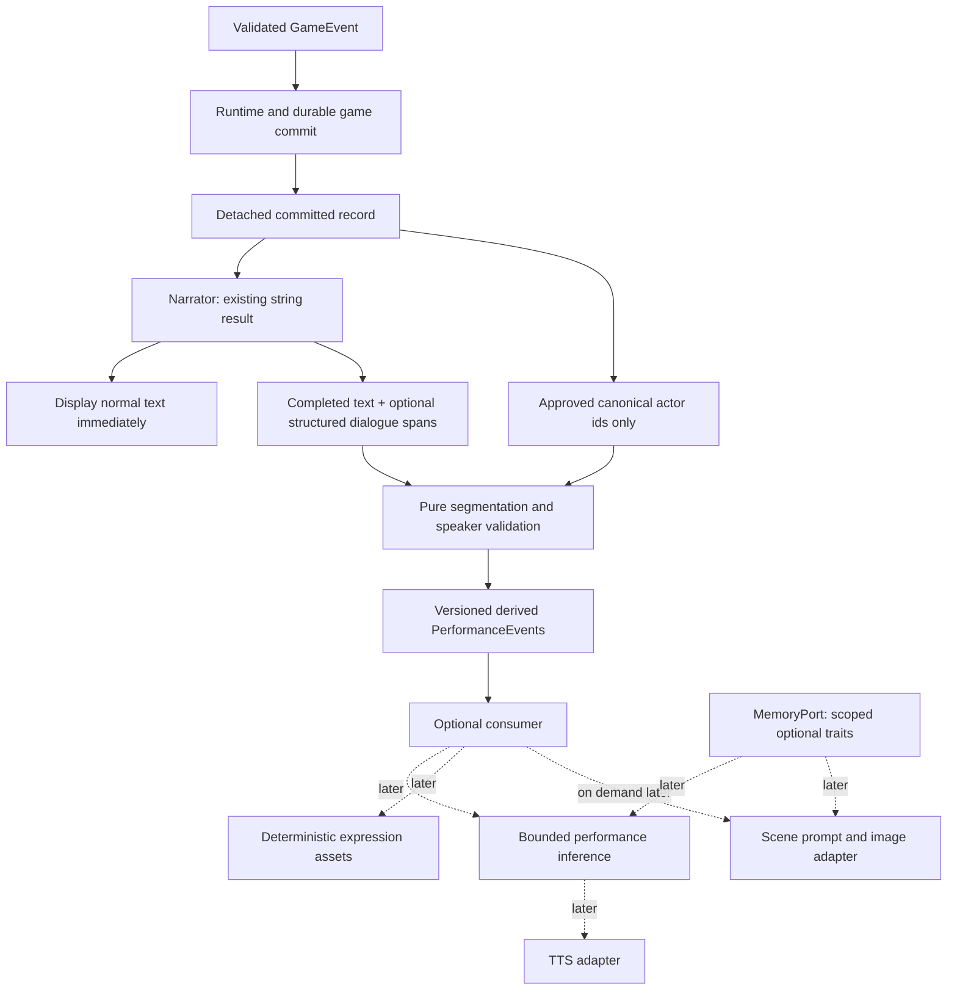

# Optional performance layer: investigation and design

Reviewed 2026-10-04. Decision: **foundation now; a complete VN experience later**.
The smallest useful primitive is a pure, versioned projection of completed narrative text
and validated dialogue spans into canonical speaker references. It must be useful without
an inference model, TTS, images, NMOS, or a new frontend.

This report preceded the prototype. [ADR 0004](adr/0004-optional-performance-projection.md)
records the proposed boundary. “Proposed” below does not mean an implemented host feature.

## 1. Current SAGA, not the historical scaffold

Inspected `AGENTS.md`, `CLAUDE.md`, README, architecture, persistence, implementation plan,
RisuAI integration, reference reviews, existing ADRs, progress reports, and the corresponding
source/tests. The working tree already contained an in-progress `nmos_trpg` → `saga_trpg`
rename. Baseline HEAD was `2df2d397e09fc4711af3bacb298324716aadcc7b`; this report describes
the working tree, not just that commit. Concurrent storage/tool-tape work appeared during
the investigation; its ownership and verification are separate from this increment.

| Current entry point / type | Actual responsibility and boundary |
| --- | --- |
| [`api/app.py:create_app`](../src/saga_trpg/api/app.py) | Debug HTTP host. Dispatch/state/history/replay/branch/ruleset routes. No `/v1/chat/completions`, narrative route, SSE, WebSocket, or performance transport. |
| [`adapters/storage/sqlite.py:SQLiteWorldRepository.dispatch`](../src/saga_trpg/adapters/storage/sqlite.py) | Persists dispatch results before returning; branch-scoped event/idempotency identity. Reads provide detached records. |
| [`runtime/engine.py:RuntimeEngine.dispatch`](../src/saga_trpg/runtime/engine.py) | Validates event envelope, checks duplicate proposals, copies state, applies selected rules, validates transition, journals before exposing state. |
| [`domain/models.py`](../src/saga_trpg/domain/models.py) | `WorldState.actors: dict[str, ActorState]`, `ActorState.actor_id`, exact mechanics, `RuleResult` facts/rolls/patches/trace. No display-name registry or formal PC/NPC/companion role enum. |
| [`runtime/journal.py:JournalEntry`](../src/saga_trpg/runtime/journal.py) | Versioned committed event + full result with state hashes. Not a generic presentation event bus. |
| [`runtime/replay.py:replay_recorded_results`](../src/saga_trpg/runtime/replay.py) | Checks identity, sequence, trace, world and state-hash chain; rebuilds from recorded results without rules/dice. |
| `SQLiteWorldRepository.get_state`, `.replay`, `.fork` | Snapshot recovery, genesis replay, copied immutable branch prefixes with provenance. Event identity is scoped to world/branch. |
| [`ports/narrator.py:NarrationRequest`, `NarratorPort.render`](../src/saga_trpg/ports/narrator.py) | Async request-to-`str` interface. Request contains event/result/memories/recent dialogue; no streaming or durable narrative identity. |
| [`adapters/narrator/fallback.py:FallbackNarrator.render`](../src/saga_trpg/adapters/narrator/fallback.py) | Joins committed facts into text. Repository tests manually construct narration requests and rerender; HTTP dispatch does not call this narrator. |
| [`adapters/risu/openai_proxy.py`](../src/saga_trpg/adapters/risu/openai_proxy.py) | Orchestration design placeholder, not an active proxy. Existing oneuldo reference documents host message ids, not a finished SAGA binding. |
| [`ports/memory.py:MemoryPort`](../src/saga_trpg/ports/memory.py) | Semantic retrieval/write boundary. `NullMemory` works; `NMOSAdapter` methods still raise `NotImplementedError`. Fail-soft orchestration remains a host responsibility. |
| [`modules/catalog.py:RulesetRegistry`](../src/saga_trpg/modules/catalog.py) | Pins ruleset id/version and closed action contracts for example modules. Performance must not implement rules or parse mechanics from prose. |

The executed game path is:

```text
structured HTTP GameEvent
  -> SQLiteWorldRepository.dispatch -> RuntimeEngine.dispatch -> selected rules / DicePort
  -> committed JournalEntry + optional snapshot -> returned facts/state/rolls

separate existing narration example/test:
get_event -> detached NarrationRequest -> FallbackNarrator.render -> str
```

Free-text intent interpretation, production narration, memory orchestration and actual
streaming are still integration work. `NarrativeEvent` and `DialogueEvent` are not existing
authoritative SAGA types. Adding them to the game journal would silently expand game semantics.

### Evolving durable tool boundary

The working tree gained [`domain/tools.py`](../src/saga_trpg/domain/tools.py),
[`ports/tools.py`](../src/saga_trpg/ports/tools.py),
[`adapters/storage/tool_tape.py`](../src/saga_trpg/adapters/storage/tool_tape.py),
[`adapters/dice/recorded.py`](../src/saga_trpg/adapters/dice/recorded.py), and storage version 2.
`ToolCall` includes world/branch/event/call key, tool/protocol versions, arguments and context
hash. `SQLiteToolResultTape.execute` persists a claim before external work and a result before
return; ambiguous `pending` claims cannot be automatically retried. `RecordedDice` reads saved
rolls or requests an outer execution. This is useful precedent for paid presentation jobs.

Do **not** put TTS/image calls in mechanical dispatch or mark them as required committed
rolls. Tool-event reservation and commit/fork lifecycle serve game actions. Presentation
has many renditions and rebuilds per game event, independently removable media, and fail-open
completion. Reuse compatible execution/idempotency concepts later, after reviewing the final
tape contract; use a distinct presentation namespace/store with no game commit dependency.
This increment does not modify storage versions or claim the concurrent tape work as its own.

## 2. Reference evidence

### Reddit VN performance demonstration

[The public thread and video comment](https://www.reddit.com/r/SillyTavernAI/comments/1wwsgqv/comment/pdn8dm6/?context=3)
were readable. The author describes narrator-generated speech annotations, streaming
detection, lore-linked speakers, vocal cues and artwork switching, and reports poorer
instruction compliance from cheaper narrators. The post names Gemini TTS-flash. This
supports separating story composition from optional performance direction.

Evidence limit: the tool exposed the video poster/comment, not playable audiovisual content.
No timing, lip/audio alignment, actual parser correctness, provider behavior or unpublished
implementation was verified. Streaming behavior is the author's report, not measured evidence.
A separate voice pass is an architectural inference/recommendation, not something the post
proves is implemented. No unpublished code was sought or reconstructed.

### Contextual Scene Painter

Reviewed public source at
[`164b63ccc26408437a057e4d6728f680ae4527f5`](https://github.com/i5031337/sillytavern-contextual-scene-painter/tree/164b63ccc26408437a057e4d6728f680ae4527f5),
manifest version 1.2.0. Source review only; no SillyTavern installation or provider execution.
Root and utility licenses are MIT, copyright 2026 i5031337. No source was copied.

| Pinned source | Observed behavior | Useful SAGA adaptation |
| --- | --- | --- |
| [`index.js`](https://github.com/i5031337/sillytavern-contextual-scene-painter/blob/164b63ccc26408437a057e4d6728f680ae4527f5/index.js) | Explicit scene/background commands build a prompt, optionally let the user edit it, then dispatch `/sd`; failures produce UI errors. Scene prompt content is debug-logged. | On-demand scene generation, distinct background/foreground intent, optional prompt preview. Avoid raw private prompt logging. |
| [`prompt-builder.js`](https://github.com/i5031337/sillytavern-contextual-scene-painter/blob/164b63ccc26408437a057e4d6728f680ae4527f5/prompt-builder.js) | Assembles recent visible chat, optional card/persona/lore, an anchor message, task-specific instructions and token estimates. Lore lookup is caught. Names/avatar matches resolve characters. | A narrowly scoped visual context projection and explicit budget, using SAGA actor ids instead of fuzzy card identity. |
| [`utils/api-connection.js`](https://github.com/i5031337/sillytavern-contextual-scene-painter/blob/164b63ccc26408437a057e4d6728f680ae4527f5/utils/api-connection.js) | Uses `generateRaw`, optional queued global profile switching with restoration, `/sd` dispatch, and chat metadata/CSS background application. | Separate prompt-generation provider from image provider. Inject independent clients/configuration; avoid global narrator-profile mutation. |

Code caveats: `buildRecentMessagesBlock` accepts the first message even when over budget;
a zero history allowance falls back to a default budget. The total limit warns rather than
strictly truncates all inputs. Thus the README's budget description is not a hard guarantee.
Character/persona/lore inclusion defaults on in `settings.js`; SAGA should opt in to selected
fields. The local profile queue coordinates this extension's tasks, not all host generation.
There is no evidenced SAGA-style journal/replay/canonical actor contract here. Borrow the
separation and user controls, not the global host state, slash-command transport, or identity
heuristics. These are static code observations, not runtime defect reproductions.

## 3. Gaps and alternatives

SAGA already has committed facts, canonical actor ids, detached reads, branch provenance,
ruleset versions and replay. Missing: rendition identity, structured dialogue spans, delivery
metadata, presentation storage, provider capability contracts and frontend transport.
It also lacks a visibility projection suitable for sending full `NarrationRequest` externally;
detached state prevents mutation but does not make hidden information safe to disclose.

| Approach | Benefit | Cost / reliability | Decision |
| --- | --- | --- | --- |
| A: narrator emits everything | Scene intent in one call; earliest possible metadata | Added prompt/output burden, malformed or omitted annotations, provider/model coupling; constrained JSON still cannot ensure correct attribution | Optional hints only. Never require emotion/tone formatting for a valid turn. |
| B: separate performance model | Independent model/budget, simple narrator | Extra call/latency, possible speaker hallucination; schema validates syntax and enums, not meaning | Later opt-in for ambiguous spans/fields; evaluate accuracy, abstention and cost on fixtures before adopting. |
| C: hybrid | Deterministic work first, inference only where useful | Requires explicit provenance and conservative unknown handling | Recommended. Structured attribution when known; no inferred canonical entity creation. |

Do not add a second memory/vector store, performance fields on `WorldState`, a second rules
engine, a mandatory serial provider chain, a universal stream bus, speculative managers,
3D/VRM, or a full VN frontend. Do not assume typography alone reliably identifies speech.

## 4. Recommended flow and smallest foundation



The foundation lives in `presentation/models.py`, `presentation/segmentation.py`,
`presentation/service.py`, and `ports/performance.py`. No code in `domain/` or deterministic
`runtime/` calls it. `NarratorPort.render -> str` stays compatible. A host can submit sidecar
JSON without embedding markup in the visible text. No parser for arbitrary `[[SPEECH]]`
tags is added. Malformed tags remain ordinary text; future TTS should avoid reading markup.

The optional helper takes **already completed text**; it does not commit or generate it.
The caller shows text before awaiting consumption. The default disables performance entirely.
The production API remains text/state-only until the RisuAI host work explicitly adopts this
helper. Integration fixtures connect an actual committed record and narrator to a fake consumer;
that is not a claim of a live RisuAI feature.

Example after retrieving a committed entry and receiving text from `NarratorPort.render`:

```python
from saga_trpg.presentation.models import NarrativeSource
from saga_trpg.presentation.service import present_narrative

# Display text here before awaiting optional consumption. The host owns rendition_id.
source = NarrativeSource(
    world_id=entry.result.state.world_id,
    branch_id=branch_id,
    game_event_id=entry.committed.event.event_id,
    narration_id=rendition_id,
)
# Apply the host's audience/visibility filter as well before supplying these ids.
actor_ids = frozenset(
    key for key, actor in entry.result.state.actors.items() if key == actor.actor_id
)
presentation = await present_narrative(
    text,
    source=source,
    actor_ids=actor_ids,
    annotations_json=optional_sidecar_json,
    enabled=performance_enabled,
    consumer=optional_consumer,
)
```

## 5. Data contracts and speaker identity

All implemented presentation models forbid extra fields and use immutable, strictly typed
values. Top-level metadata/event schemas are version 1. Strings/offsets describe presentation,
not gameplay truth. Offsets are zero-based, end-exclusive Unicode **code point** positions in
the exact original Python string, without whitespace normalization. JS UTF-16 offsets must be
converted by the host; emoji/non-BMP text is a required integration case.

```text
NarrativeSource {
  world_id, branch_id, game_event_id, narration_id
}
SpeakerRef = {kind: "actor", actor_id: canonical id}
           | {kind: "narrator", actor_id: null}
           | {kind: "unresolved", actor_id: null}
DialogueMetadata {schema_version: 1, spans: [
  {start: int, end: int, speaker: SpeakerRef}
]}
PerformanceEvent {
  schema_version: 1, producer_version: "segments-v1",
  event_id, source: NarrativeSource, text_hash,
  segment_index, start, end, kind: "text" | "dialogue",
  text, speaker: SpeakerRef
}
```

`narration_id` is a host-owned rendition identity, reused for retries of the same rendition
and changed on regeneration even if the text repeats. It is not an actor UUID and not a
game action id. The pure helper cannot verify persistence/uniqueness of caller-owned ids.
`text_hash` covers exact raw text; event identity hashes the complete versioned event payload
except its own id. World/branch/rendition/text/offset/speaker/version changes therefore cannot
silently reuse the same event id. Hashes support deduplication, not authentication or privacy.

Validate the whole sidecar before using any span: complete JSON, supported version, closed
fields, integer offsets, positive length, within text, sorted and non-overlapping. A bad
sidecar becomes one unclassified text event and an `invalid` metadata status. Missing sidecar
produces the same safe text fallback with `absent` status. Valid gaps remain unclassified
text, not asserted narration; a narrator reference must be explicit. Empty text yields no
events. Concatenating segment texts always reproduces the original input exactly.
Sidecars are limited to 65,536 characters and 1,024 spans; exceeding either falls back to text.
JSON Schema describes the closed field shapes; runtime validation additionally checks speaker
field consistency, code point lengths, overlap and bounds. Consumers are trusted host code,
not an in-process security sandbox; the isolation guarantee is that this interface passes no
mutable authoritative state or game mutation capability.

Resolve actor references by exact membership in the approved canonical ids from the **event's
committed snapshot**, not the current branch head. The host must intersect `WorldState.actors`
keys with matching `ActorState.actor_id` values and its visibility policy; inconsistent entries
must not create aliases. Player, NPC and companion all use this same reference. There is no
role inference from `player`, names, casing, pronouns, NMOS, or fuzzy matching. An unknown id
becomes unresolved, never a new entity. A line spoken by an invented off-screen character
can remain unresolved. Identity resolution validates that an id exists, not that attribution
is semantically correct. No model receives a mutable state/repository through this boundary.

Proposed later `PerformanceDirection` (not implemented): a separate versioned annotation
referencing `event_id`, with bounded optional emotion/tone/vocal cue/expression fields,
field provenance (`explicit`, `deterministic`, `inferred`), confidence/abstention, analyzer and
policy versions. Do not add unsupported provider controls to the game event schema.

Proposed `TTSProvider`: `capabilities()` and async synthesis of one segment plus selected
voice/config. Capabilities identify supported voice selection, emotion/style, speed, vocal
events and streaming; output reports applied/ignored controls and media metadata. Unsupported
controls are omitted, never rendered literally as dialogue. Voice selection uses canonical
actor id plus a user-managed voice map; unresolved speakers use neutral/no voice. Null/disabled,
local Qwen-family, Gemini and other adapters share this contract without hard-coded models.

Proposed visuals: start with deterministic `(actor_id, expression, asset-pack version)` lookup
and a neutral/previous asset fallback. Add a scene-image adapter only when needed; prompt
generation, rendering and current-speaker focus are distinct tasks. A separate `VisualDirector`
class is unnecessary until actual routing complexity warrants it. Scene hints cannot change
position, weather, presence or relationship truth.

## 6. Persistence, replay, branching and rebuild policy

| Information | Classification | Explicit policy |
| --- | --- | --- |
| Game events, exact state, roll results, branch prefixes | Authoritative mechanics | Existing repository/journal and replay only. Performance never affects their hashes. |
| Raw narrative text | Generated fiction; durable presentation input when archived | Save each completed rendition verbatim with source and hash in a future opt-in archive. Current narrator/foundation does not persist it. Not proof of mechanical facts. |
| Dialogue segmentation | Derived | Save versioned projection for exact presentation replay; rebuild from archived text and explicit spans if requested. Never invent lost spans from the mechanical journal. |
| Performance inference | Derived, nondeterministic | Save the accepted annotation and analyzer/prompt/schema versions. Rebuild creates another projection revision, not a historical rewrite. |
| Chosen voice and applied controls | Presentation decision | Save resolved voice/provider/settings version with artifact manifest; do not use today's voice mapping for historical playback. |
| Generated audio | External output / optional cache | Keep content hash, format, duration and blob reference; exact playback requires retained bytes. Missing bytes -> text; regeneration is explicit and may differ/cost money. |
| Expression choice | Derived asset selection | Save asset id, pack version/hash and selection policy; use neutral/current visual if missing. |
| Scene prompt | Derived, private | Optional archive with minimized context digest and generator/config versions. Restrict access like dialogue. |
| Generated image | External output / optional cache | Hash and retain bytes/reference according to explicit retention; missing image keeps existing/default visual. |
| Provider/model/version metadata | Presentation provenance | Save actual reported versions when available and requested settings separately; provider aliases are not reproducibility guarantees. Never store credentials. |

There are four operations: **mechanical replay** (no narration/providers), **saved presentation
playback** (read retained records/media, no calls), **narration regeneration** (same committed
event, new rendition), and **performance rebuild** (same text, new projection/provider job).
The last two are explicit actions, never implicit work triggered by replay/reconnect.

The foundation persists nothing and guarantees only deterministic re-projection for the same
inputs/version. It does not claim audiovisual reproduction. Future archive writes occur after
game commit; archive failure cannot roll back the turn. A crash between commit and narration
leaves a valid mechanical turn without presentation. A crash after remote synthesis but before
artifact recording leaves ambiguous paid work: record job identity/claim first, reconcile if
supported, otherwise require explicit retry. Do not promise exactly-once remote effects.

Branch event ids may be inherited, but presentation source always includes branch id. A future
archive may share immutable media blobs across branches only after checking identical inherited
event/rendition provenance and visibility; projection ownership remains scoped to the branch.
Deletion/retention of optional media must not invalidate mechanical replay. No archive schema
or database migration is introduced here.

## 7. Streaming and delivery

There is currently no suitable frontend event stream to extend. Keep the foundation a local
typed port, not a new transport. When the host gains streaming, extend that host transport
with optional frames; keep `NarratorPort` compatibility via a separate optional capability.

Proposed frame envelope: schema version, world/branch/game event, rendition id, projection
revision, monotonically increasing stream sequence, stable frame id, type and typed payload.
Possible types: `narrative.delta`, `dialogue.start/delta/end`, `performance.ready`, `tts.ready`,
`visual.expression`, `visual.scene`, plus completed/cancelled terminal status.

- Send narrative only after commit; text deltas need no performance metadata.
- Buffer incomplete structured metadata with byte/span limits. Do not perform TTS based on
  partial JSON/tags. Validate completed segments; interrupted/malformed metadata falls back
  to visible text. This prototype handles completed strings only.
- Retries reuse committed action identity, but changed generation gets a new rendition.
  Cancellation stops optional jobs where supported; late completions cannot update an old
  swipe/branch/rendition. Already billed remote work may still finish.
- Consumers use event/frame id to upsert, and reject stale rendition/revision. Text order is
  segment/stream sequence, never provider completion order; late segment audio may be skipped.
- Reconnect uses a durable cursor and saved projection, never restarts models/TTS. Until a
  cursor/archive exists, only a text snapshot fallback is promised. Bounded queues drop
  optional enrichment under backpressure before delaying text.
- Foundation consumers must deduplicate by `PerformanceEvent.event_id`. Repeated projection
  emits identical ids. No built-in durable inbox/outbox or cross-process delivery guarantee
  is claimed; an in-memory fake demonstrates the consumer contract only.

## 8. Failure model

| Failure | Required user outcome / policy |
| --- | --- |
| Performance disabled | Original text; zero segmentation/consumer work. |
| Missing annotations | Original text, unresolved/unclassified segment; no guessing. |
| Malformed/partial/overlapping annotations | Reject whole sidecar; preserve all text; report `invalid`. |
| Unknown canonical id | Unresolved speaker; no actor creation, name lookup or memory override. |
| Performance model invalid/refusal/timeout | Use deterministic projection or text; bounded budget, no automatic repair call. |
| Consumer exception/deadline | Report failed/timed-out delivery, keep text and events for caller inspection; no hidden retry. Default cooperative timeout 250 ms in the local helper. |
| Cancellation | Propagate cancellation; never convert it into another dispatch. Async consumers must cooperate with cancellation and must not block the event loop. |
| TTS unavailable/unsupported capability | Text remains; unsupported controls omitted; no implicit paid fallback. |
| Expression missing | Neutral/previous approved asset. |
| Image/prompt provider failure | Keep current/default visual. |
| NMOS failure/no permitted memory | Continue with visible text and approved local traits; no mandatory retrieval. |
| Archive/media miss | Text/saved metadata; no silent regeneration. |
| Game commit/storage failure | Existing game error policy; do not present success through performance. |

No provider failure can invalidate an already committed turn. Logs should record status and
safe correlation ids, not dialogue, memories, provider exception bodies or secrets. A timeout
is a local cooperative deadline, not proof that remote execution stopped. This prototype
has no remote providers and no retry loop.

## 9. Latency and cost

```text
time ->
game      [validate / rules / recorded tools / durable commit]
narrator                                                   [first tokens .... final text]
display                                                     ^ show text continuously later
foundation                                                                     [spans -> ids]
assets                                                                         [lookup -> UI]
inference                                                                      [optional bounded pass]
TTS                                                                            [neutral or directed audio]
scene                                                                    click [prompt -> optional image]

future streaming: process each CLOSED segment while later text is still arriving
```

Current `render()` only returns at completion. The first visible text today cannot precede
that return; the progressive line is a future host capability, not prototype latency evidence.
The foundation adds zero model calls. Pure processing is linear in text/span work; hashing
and payload size should be profiled before long-history use. The local helper is called after
text is shown and its consumer has a bounded cooperative wait.

Let G be game commit time, N first narrative token, S first closed segment, P optional inference,
A audio synthesis, I image generation. Future text latency is G+N; first audio can be G+S+A
with a default voice, or G+S+P+A with requested direction. Image work never appears in either
formula. TTS that depends on direction cannot truthfully be called fully concurrent with that
direction pass; apply a cutoff/default voice or wait only in the optional audio path.

Cost per turn = narrator + selected inference segments + synthesized characters/audio +
explicit images. No dollar/latency claim was benchmarked. Bound context, output, concurrency,
queue depth and per-turn/session spend; use cached artifacts and deterministic assets first.
Skip inferred emotion on ordinary narration and generate backgrounds on demand or a confirmed
scene change, not every token. Metrics: text latency, first audio, invalid sidecars, unresolved
speaker rate, human-attribution accuracy, cancellation/stale-result drops and cost per turn.

## 10. Security and privacy

External provider integration requires a separate reviewed increment. This foundation sends
no network requests and does not change authentication or authorization.

- Host controls source ids, approved actor ids and visibility; model/lore output cannot widen
  actor access, select provider endpoints or authorize tools. A matching id is not proof of truth.
- TTS receives one approved dialogue segment, selected voice and bounded direction. It should
  not receive the character card, journal, entire world or NMOS history.
- A scene provider receives approved visible appearance/environment traits and a bounded prompt.
  Retrieve memory only through `MemoryPort` with world/actor scope; filter it again for purpose
  and audience. Relationship secrets and private persona details default to excluded.
- RP text and retrieved lore are untrusted data. JSON schema, size limits and allowlisted asset/
  voice identifiers constrain output. Never execute generated commands, macros, HTML, paths,
  URLs, SSML or provider instructions without the relevant adapter's validation.
- Local/disabled mode must work. Remote use needs explicit user/provider configuration,
  retention policy and export controls. No automatic transfer to a different provider on error.
- Store artifacts with scoped access and configurable retention; avoid raw-text logs. Content
  hashes do not anonymize predictable dialogue or identities. Do not put credentials in models.

## 11. Small implementation increments

Paths below are exact proposed locations, not all existing files. Each phase is independently
reviewable; no phase makes optional services prerequisites for game commit.

| Phase | Modules | Tests / definition of done | Migration and compatibility |
| --- | --- | --- | --- |
| 1: local foundation, this increment | `presentation/models.py`, `presentation/segmentation.py`, `presentation/service.py`, `ports/performance.py`; `scripts/export_schemas.py`, `schemas/performance-event.schema.json`, `schemas/dialogue-metadata.schema.json` | `tests/test_performance.py`: text fidelity, strict metadata rejection, canonical identity, deterministic ids, duplicate consumer handling, disabled/failure/timeout/cancel, SQLite replay/rerender isolation, schema round-trip. | No DB changes, old ports/routes/runtime unchanged; no provider dependency. Done when report/schema/tests agree. |
| 2: host rendition/archive boundary | `adapters/risu/openai_proxy.py`, `presentation/archive.py`, `ports/presentation_archive.py`, `adapters/storage/presentation.py`; optional frames in `api/app.py` only after host contract review | `tests/test_presentation_archive.py`, `tests/test_risu_performance.py`: durable source identity, ten regenerations, restart, fork/swipe/edit, cursor reconnect, stale results and interrupted generations. | Separate versioned presentation storage and explicit opt-in migration; old campaigns render text without archive. Done when text arrives independently of consumer and restart playback makes zero provider calls. |
| 3: inference capability | `ports/performance_analysis.py`, `adapters/performance/inference.py`, `presentation/models.py` | `tests/test_performance_analysis.py`: schema/refusal/timeout, bounded visible context, unknown speaker abstention and fixture accuracy/cost evaluation; fake transport first. | Versioned derived annotation only; old segments playable; default disabled. Done when wrong semantic attribution is measured separately from JSON validity. |
| 4: audio | `ports/tts.py`, `adapters/tts/null.py`, `adapters/tts/fake.py`, `presentation/audio.py` | `tests/test_tts.py`: capability negotiation, neutral fallback, minimal payloads, voice-map revisions, duplicate/cancel/media misses and ordering. | Opt-in artifact/job manifests; no mechanical migration. Real local/remote adapter is a subsequent provider-specific change. Done when unsupported controls and failure preserve text with no hidden retries. |
| 5: deterministic visuals | `ports/visual.py`, `adapters/visual/assets.py`, `presentation/visual.py` | `tests/test_visual.py`: canonical asset lookup, missing expression, correct focus and stale rendition rejection. | Versioned asset map outside world state. Done when replay uses saved selection/pack and missing assets keep usable UI. |
| 6: contextual scenes | `ports/scene_image.py`, `adapters/visual/scene_image.py`, `presentation/scene_context.py` | `tests/test_scene_image.py`: fake provider, privacy projection, hard budgets, on-demand trigger, cancellation, cache/provenance and missing artifacts. | Opt-in provider/job/cache data only; game records unchanged. Done when an image outage/cost cutoff cannot delay text or commit. |

Next recommended issue: **Bind stable host narration renditions to committed SAGA events and
display text before optional consumers**, alongside the existing RisuAI turn-identity work.
Do not start with a cloud TTS/image PR. Broader priorities P0/P1 remain unchanged.

## 12. Verification record and limits

The first full baseline test attempt stopped during collection because concurrent work had
introduced tests before `migrations` and `tool_tape` modules existed. This was observed before
any performance implementation. Final commands/results and self-review are recorded in
[`progress/performance-foundation.md`](progress/performance-foundation.md).

No live Reddit audiovisual playback, SillyTavern runtime, RisuAI UI, NMOS API, performance model,
TTS, image provider, deployment, or durable presentation replay is verified by this increment.
